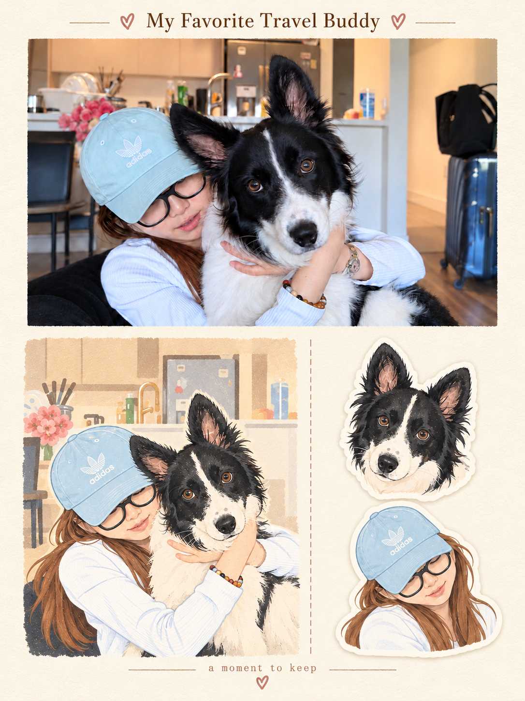

# Memory Studio

**Turn one photo into a polished 3:4 keepsake poster.**

`FastAPI` · `OpenAI Images` · `Pillow` · `Docker`

<p align="center">
  
</p>

Memory Studio is a photo-to-poster web app: upload an image, choose an art direction, and export a ready-to-download **1080 × 1440 PNG**. The project turns reusable visual prompt systems into a small product workflow instead of a collection of one-off prompts.

> **Project status:** working prototype for local or small private use. Public multi-user hosting is intentionally not enabled by default because every generation uses a paid image API and needs authentication, quotas, rate limits, and storage controls.

## At a glance

| | |
| --- | --- |
| **Input** | JPG, PNG, or WebP photo, up to 15 MB / about 24 megapixels |
| **Output** | Exact 1080 × 1440 portrait PNG |
| **Experience** | Upload → choose style → generate → preview → download |
| **Backend** | FastAPI with server-side credentials and image validation |
| **Image pipeline** | EXIF removal, provider generation, safe-area crop, resampling |
| **Deployment** | Local Python, Docker, or a Docker-capable host |

## Product flow

```text
Upload a photo
   ↓
Validate file type, size, and dimensions
   ↓
Remove EXIF metadata and reduce oversized inputs
   ↓
Combine the photo with an editable style template
   ↓
Generate with the configured image model
   ↓
Center-crop and resample to an exact 3:4 export
   ↓
Preview or download the finished poster
```

## Poster styles

| Style ID | Product label | Direction |
| --- | --- | --- |
| `scenes-gathered-zine-v1-3` | Collage Zine | Layered scenes and handmade paper fragments |
| `photo-to-zine-postcard` | Illustrated Postcard | Original photo paired with a flat illustration |
| `travel-memory-sticker-card` | Memory Sticker Card | Photo above, illustration below left, stickers below right |
| `gc-minimal-zine-poster-v0-3` | Minimal Editorial Poster | Restrained palette, typography, and generous whitespace |

The styles live in `skills/styles.json` and are editable prompt templates. They are **not imported copies of unavailable third-party skill definitions**. Image generation is probabilistic, so composition and lettering should be reviewed before printing or publishing.

## Run locally

Requires Python 3.12.

```bash
git clone https://github.com/EllieZhangy/memory-studio.git
cd memory-studio
python3 -m venv .venv
. .venv/bin/activate
pip install -r requirements.txt

# Store the key in your shell or hosting secret manager.
export OPENAI_API_KEY="your-key-here"

uvicorn app.main:app --host 127.0.0.1 --port 8000
```

Open `http://127.0.0.1:8000`. Interactive API documentation is available at `/docs`. `.env.example` lists the supported settings; `.env` is not loaded automatically.

## API

| Endpoint | Purpose |
| --- | --- |
| `GET /api/styles` | List available styles and descriptions |
| `GET /api/health` | Check service and credential presence |
| `POST /api/generate` | Generate from multipart `image`, `style`, and optional `title` |
| `GET /api/images/{id}.png` | Preview an image; add `?download=true` for an attachment |

Example:

```bash
curl -X POST http://127.0.0.1:8000/api/generate \
  -F 'image=@your-photo.jpg' \
  -F 'style=travel-memory-sticker-card' \
  -F 'title=My Favorite Travel Buddy'
```

## Privacy, cost, and limitations

- The uploaded photo is sent to the configured image provider. Review that provider's data policy before using personal photos.
- EXIF metadata is removed before transmission, and the uploaded original is not retained on disk by the app.
- Generated images are stored in `.runtime/generated`. They use unguessable IDs but do not have per-user access control.
- The photo region is recreated by the image model rather than pasted pixel-for-pixel, so faces, objects, text, and composition can change.
- Each real generation is chargeable. Protect any public deployment with authentication, quotas, rate limits, and spending controls.
- A production multi-user version should add per-user storage, a background job queue, monitoring, and cleanup policies.

## Deployment

### Docker

```bash
docker build -t memory-studio .
docker run --rm -p 8000:8000 --env OPENAI_API_KEY memory-studio
```

### Render quick start

[Deploy to Render](https://render.com/deploy?repo=https://github.com/EllieZhangy/my-ai-poster-skills)

The included `render.yaml` creates a paid Starter web service and a 1 GB persistent disk. Review current hosting and model pricing before deployment, enter the API key only through secret settings, and keep the service private or protected until usage controls are in place.

GitHub Pages cannot run this Python API. Use a Docker-capable host such as Render, Railway, or your own server.

## Validation

```bash
python -m unittest discover -s tests -v
```

The tests cover upload validation, missing credentials, provider failures, generated-image decoding, exact 3:4 export, and attachment downloads with a mocked provider. Real paid generation still needs a manual check after configuring a valid model account.

## Selected work

- [AI Driving School](https://elliezhangy.github.io/ai-driving-school/) — a voice- and text-controlled Chinese parking game.
- [Daily Mood Screen](https://github.com/EllieZhangy/Daily-Mood-Screen) — a personalized macOS wallpaper pipeline using weather, photos, and mood.
- [Radiology Impression Prediction](https://github.com/EllieZhangy/LLM-Based-Impression-Prediction-from-Radiology-Reports) — an LLM research project for radiology report impression generation.
